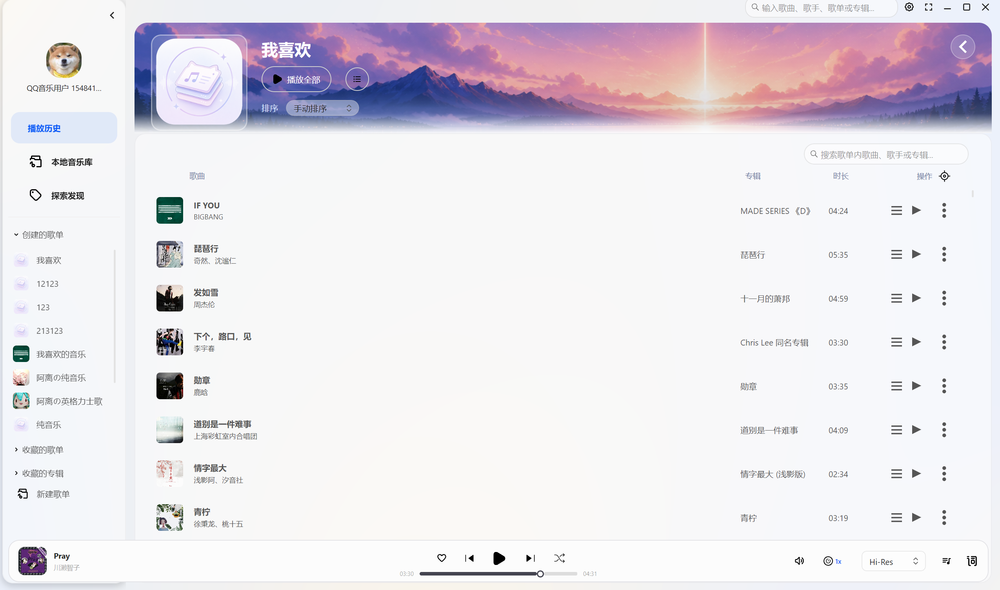

# QPlayer

> 本项目是非官方开源项目，与 QQ 音乐、腾讯及其关联公司没有隶属、授权或合作关系。
> 仅用于个人学习和技术研究，请支持正版音乐。



此项目是一个基于 Avalonia 的桌面音乐播放器(KA_Music)实验项目。项目沿用了 KA Music 的界面和部分播放器结构，并使用 `qq-music-api` 接入 QQ 音乐相关接口。

我做这个项目，主要是因为喜欢 KA Music 这套 UI 和桌面交互，同时希望按自己的使用习惯调整界面和功能。项目开发过程中大量使用了 AI 辅助，代码质量和稳定性仍有改进空间，欢迎 issue 和 pull request。

## 功能与边界

- 支持账号登录、搜索、歌单、每日推荐和歌词显示。
- 支持本地歌曲导入和本地歌单。
- 支持桌面歌词、播放队列和音质切换。
- 用户自行登录，不内置公共 Cookie。
- VIP 歌曲仍需要对应账号的会员权限，本项目不破解会员限制。
- 不提供音乐下载、DRM 绕过、批量抓取或付费内容解锁。

## 使用说明

### 登录和播放

当前在线播放要求有效登录态。你可以先登录，也可以直接播放本地导入的歌曲。

### 无法播放怎么办

1. 确认当前账号有对应歌曲的播放权限。
2. 如果会员账号仍然获取不到 URL，退出后重新登录。
3. 如果已经获取到 URL 但无法播放，尝试关闭系统代理。
4. 如果第三方接口临时不可用，请稍后再试；接口变化可能导致部分功能失效。

### 歌单说明

「我的歌单」页当前提供三类歌单：

- **本地歌单**：无需登录，在「我的歌单」页点击「新建歌单」创建。歌曲保存在本机 `AppSqliteStore`，支持创建、重命名、删除和移除歌曲。QQ 音乐接口暂无云端写歌单能力，因此本地歌单不会同步到 QQ 云端。
- **我喜欢的音乐**：需要 QQ 登录，自动解析当前账号的「我喜欢」歌单并展示歌曲，具体数量以账号实际数据为准。
- **QQ 云端歌单**：需要 QQ 登录，可查看账号创建的歌单并播放其中的歌曲。云端删除或移除歌曲暂不支持，因为当前接口只读。

## 自动更新与版本覆盖

本项目的更新检查代码沿用了上游 KA Music 的部分实现。建议关闭自动更新功能，否则可能下载到上游 KA Music 的版本并覆盖当前客户端。

## 从源码运行

### 环境要求

- Windows 10/11 x64
- .NET SDK 10.0.400 或兼容版本
- Node.js 20 或更高版本，仅从源码启动 API 时需要

### 启动 API

API 使用本地 Node 服务，默认地址为 `http://localhost:3200`。

```powershell
cd qq-music-api
npm install
npm run dev
```

### 启动客户端

```powershell
dotnet run --project src\Apps\KugouAvaloniaPlayer\KugouAvaloniaPlayer.csproj -p:TargetFrameworks=net10.0-windows10.0.19041.0
```

## 仓库结构

客户端仓库的建议结构如下。目录名 `KugouAvaloniaPlayer`、`KuGou.Net` 和 `KugouTaskbar*` 是从上游沿用下来的内部名称，不代表当前项目仍使用酷狗接口。

```text
QPlayer/
├─ src/
│  ├─ Apps/
│  │  ├─ KugouAvaloniaPlayer/          # Avalonia 桌面客户端
│  │  ├─ KgTest/                       # 终端 TUI 播放器
│  │  ├─ KgWebApi.Net/                 # ASP.NET Core Web API
│  │  └─ AvaloniaSilkEffects.Showcase/ # 特效展示程序
│  ├─ Libraries/
│  │  ├─ QqMusic.Net/                  # QQ 音乐接口 SDK
│  │  ├─ KuGou.Net/                    # 上游遗留 SDK，保留用于对照和兼容
│  │  ├─ SimpleAudio/                  # 音频播放与音效层
│  │  ├─ AvaloniaLyrics/               # Avalonia 歌词控件
│  │  └─ AvaloniaSilkEffects/          # 背景特效库
│  ├─ Native/
│  │  ├─ KuGou.Net.Native/             # Native AOT 导出层
│  │  ├─ KugouTaskbarLyricsNative/     # 任务栏歌词原生代码
│  │  └─ KugouTaskbarNative/           # 任务栏集成原生代码
│  └─ Tests/
│     └─ AvaloniaSilkEffects.Tests/    # 特效库测试
├─ docs/
│  ├─ images/                          # README 截图和演示图
│  └─ branding/                        # 品牌资源，公开前需替换
├─ tools/                              # 辅助脚本
├─ Directory.Packages.props
├─ global.json
├─ KugouMusic.NET.slnx
├─ LICENSE
├─ THIRD_PARTY_NOTICES.md
└─ README.md
```

`qq-music-api` 建议作为独立仓库发布，不要在客户端仓库里提交它的 `.git`、`node_modules` 或 `dist`。如果把它放进同一个仓库，应先删除其内部 `.git`，再用普通目录方式提交，不能只提交一个子模块指针。

API 仓库的主要结构：

```text
QPlayer-API/
├─ api/                  # API 入口和部署相关代码
├─ config/               # 配置模板，不提交用户登录信息
├─ docs/                 # API 文档
├─ packages/             # npm 工作区包
├─ plugins/              # 插件
├─ public/               # 接口浏览页面等静态资源
├─ scripts/              # 构建和辅助脚本
├─ src/                  # API 源码
├─ tests/                # 测试
├─ package.json
├─ LICENSE
├─ THIRD_PARTY_NOTICES.md
└─ README.md
```

## 来源与许可

- 客户端基于 [Linsxyx/KugouMusic.NET](https://github.com/Linsxyx/KugouMusic.NET) 修改，原作者 Linsxyx，MIT License。
- API 基于 [sansenjian/qq-music-api](https://github.com/sansenjian/qq-music-api) 修改，上游为 [Rain120/qq-music-api](https://github.com/Rain120/qq-music-api)，MIT License。
- 本项目修改部分按 MIT License 发布，完整声明见 `LICENSE` 和 `THIRD_PARTY_NOTICES.md`。

灵感来源：

- [KuGouMusicApi](https://github.com/MakcRe/KuGouMusicApi)
- [folia-major](https://github.com/chthollyphile/folia-major)
- [sansenjian/qq-music-api](https://github.com/sansenjian/qq-music-api)
- [Linsxyx/KugouMusic.NET](https://github.com/Linsxyx/KugouMusic.NET)

## 免责声明

- 本项目按 MIT License 发布，维护者不提供商业授权、商业支持或可用性保证。
- 项目仓库不包含音频文件；运行时的缓存和本地歌单只保存在用户本机。
- 所有音乐、封面、歌词及相关内容的版权归原平台及相应权利人所有。
- 本项目不保证第三方接口长期可用，接口变化可能导致部分功能失效。
- 用户应自行遵守平台服务条款，并承担账号和登录凭证的安全责任。
- 如权利人认为本项目侵犯其权益，请联系维护者，维护者会及时删除相关内容。
